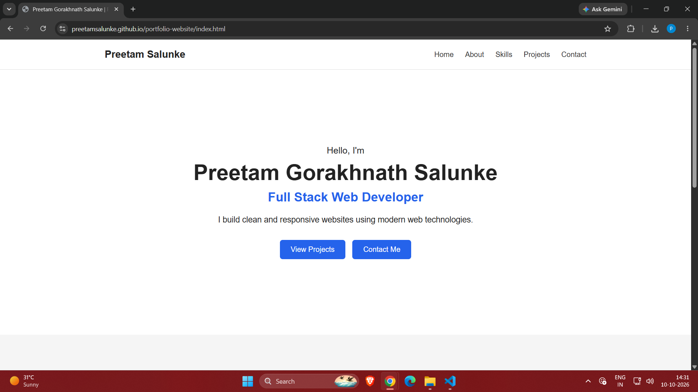
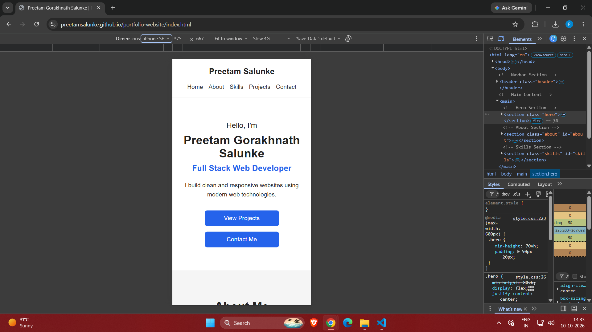
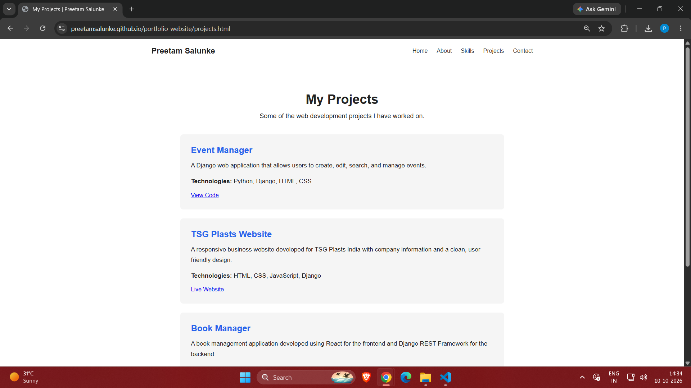
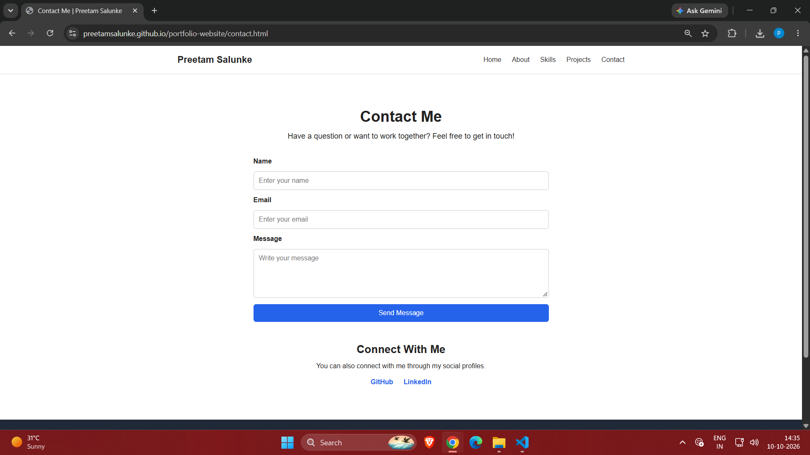

# Personal Portfolio Website

A responsive personal portfolio website developed
using HTML5 and CSS3.

## About the Project

This portfolio showcases my profile, technical skills,
education, certifications, and web development projects.

## Features

- Responsive homepage with hero section
- About page with education and certifications
- Skills and technology stack section
- Projects page featuring three projects
- Contact page with a basic HTML form
- Navigation between all pages
- Responsive layouts for mobile and desktop
- Footer with navigation links

## Technologies Used

- HTML5
- CSS3
- Flexbox
- CSS Grid
- Media Queries
- Git and GitHub

## Pages

- Home - index.html
- About - about.html
- Projects - projects.html
- Contact - contact.html

## Featured Projects

1. Event Manager - Django-based event management project
2. TSG Plasts Website - Responsive business website
3. Book Manager - React and Django REST API project

## Live Website

[View My Portfolio](https://preetamsalunke.github.io/portfolio-website/)

## GitHub Repository

[Portfolio Source Code](https://github.com/PreetamSalunke/portfolio-website)

## Screenshots

### Desktop Homepage

### Mobile Homepage

### Projects Page

### Contact Page

## Project Structure

portfolio-website/
- index.html
- about.html
- projects.html
- contact.html
- css/style.css
- js/script.js
- assets/
- screenshots/
- README.md

## How to Run Locally

1. Download or clone this repository.
2. Open the project folder.
3. Open index.html in your web browser.

## Contact Form

The contact form includes Name, Email, and Message
fields with basic HTML validation.

Backend message submission is not implemented.

## Author

Preetam Gorakhnath Salunke

Full Stack Web Developer
